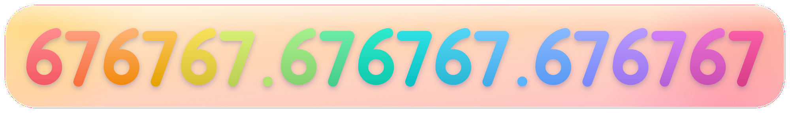
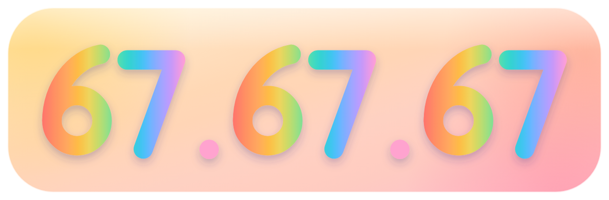

# Changelog

> **TLDR: The more 67s the better.**

All notable changes to **VSCode Gradient Themes** will be documented in this file.

## [67676767.67676767.67676767] - 2026-11-09

### Added, Changed & Fixed
- **Universal Gradient UI Chrome & Single-Pill Hover Effects (`css/rainbow-gradient-light.css`, `css/rainbow-gradient-dark.css`, `js/gradient-randomizer.js`)**:
  - Styled Walkthrough cards & steps, Tree/List Filter boxes, Titlebar Update button, Command Center search box, Activity Bar & Profile badges, and Status Bar `"Reload for Gradient"` pills with frosted aurora fills and `1.5px` 4-color gradient frames.
  - Added single-pill gradient hover highlights across File Explorer rows, Chat/Sessions rows, Terminal tabs, Panel header tabs, Editor tabs, Activity Bar actions, and Status Bar items with zero `:has()` ancestor invalidation.
  - Added a vertical `180deg` gradient editor split sash (`.monaco-sash.vertical:before` starting cleanly below the editor tab strip), vertical `180deg` scrollbar sliders (`.scrollbar.vertical > .slider`), and vertical `180deg` Editor & Terminal text cursors.
- **Full-Workbench Breathing Aurora Sync & Smooth Syntax Breathing (`js/gradient-randomizer.js`, `css/`)**:
  - Synced 100% of floating widgets (`.find-widget`, `.parameter-hints-widget`, `.suggest-widget`, `.monaco-hover`, `.quick-input-widget`, `.monaco-menu`, `.notification-toast`), active terminal tab indicators, terminal cursors, editor highlight overlays, and hovered elements (including stationary cursor hovers) with `Breathing Aurora` via `inherits: false` `--prism-local-*` custom properties.
  - Added smooth 5 FPS syntax highlighting breathing (`#prism-syntax-style`) with pre-interpolated readable stops and append-only sorted `.mtk*` slot assignment to eliminate color jumps on palette morph completion or raw Markdown scrolling.
- **Direct Vietnamese / CJK IME Terminal Streamer (`js/gradient-randomizer.js`, `css/`, `extension.js`, `install.py`)**:
  - Disabled xterm.js's black `.composition-view` buffer box in the integrated terminal and added a capture-phase IME streamer on `.xterm-helper-textarea` that diffs and forwards composed characters directly to the PTY keystroke-by-keystroke.
  - Added automatic `workbench.esm.html` patching alongside `workbench.html` across `install.py` and `extension.js` so all CSS and JS fixes survive VS Code updates automatically.

## [676767.676767.676767] - 2026-11-08

### Changed & Fixed
- **Animated 6-Scene Gradient Logo & Light-Theme Living Aurora Overview GIFs (`media/icon-animated.gif`, `media/screenshots/rainbow-overview.gif`, `README.md`)**:
  - Added a 6-scene continuous-morph animated VS Code logo (`Original VS Code` → `Prism Classic` → `Matcha Yuzu` → `Sunset Lagoon` → `Amalfi Citrus` → `Arctic Sunbeam`) with authentic 3D ribbon facet shading over 20%+ lighter pastel aurora squircle tiles, plus a zero-jitter 80-frame Light Theme `Gradient Studio` + `Palette Prism` continuous-morph overview loop.
- **Zero-Subtree-Walk `Breathing Aurora` Engine (`js/gradient-randomizer.js`, `css/rainbow-gradient-dark.css`, `css/rainbow-gradient-light.css`)**:
  - Registered `--prism-local-bg`, `--prism-local-bar`, and `--prism-local-border` via `CSS.registerProperty` with `inherits: false` so live breathing updates on Split-Panel containers (`.part.editor`, `.part.sidebar`, `.part.panel`, etc.) and UI chrome elements (`.sticky-widget`, `.terminal-sticky-scroll`, `.tab.active`, `.monaco-list-row.selected`, `.current-line`, `.selected-text`, `#prism-randomizer-swatch`) trigger `kLocalStyleChange` on only the target element (`0` child nodes traversed) without mutating `.monaco-workbench` custom properties during 100ms ticks.
  - Eliminated `#prism-syntax-style.textContent` stylesheet re-parsing during breathing ticks and scoped `::selection` to `:is(input, textarea)::selection`, removing 10,000-node `SubtreeStyleChange` walks and Oilpan `CSSGradientValue` GC sawtooth churn.
- **Upgrade Reload Prompt & Single-Source-of-Truth Versioning (`extension.js`, `package.json`, `install.py`, `build_themes.py`)**:
  - Updated `autoSyncWorkbenchOnStartup` so upgrading from a previous version always displays the status bar reload pill and `"Reload Window"` prompt when `workbench.html` is updated to a new CSS/JS hash.
  - Consolidated version lookup to `package.json` across all scripts and added one-command version bumping and VSIX packaging (`python3 install.py -v <version> -p` / `npm run bump -- <version>`).

## [67.420.69] - 2026-11-08

### Changed & Fixed
- **Terminal Sticky Scroll Gradient Framing & Opaque White Bar Fix (`css/rainbow-gradient-dark.css`, `css/rainbow-gradient-light.css`)**:
  - Forced `.xterm-scrollable-element`, `.hover-overlay`, and `.hover-overlay:hover` inside `.terminal-sticky-scroll` to `background: transparent !important` so xterm.js inline styles (`#FFFFFF`) no longer paint an opaque white bar at the top of the terminal.
  - Styled `.terminal-sticky-scroll` with the same 3-layer opaque canvas + gradient fill (`--g-panel-bar` / `--g-side-bar` / `--g-chat-bar` / `--g-editor-bar`) + `1.5px` 4-color gradient frame as Editor Sticky Scroll, with WebGL/canvas `mix-blend-mode` support (`multiply` in Light, `screen` in Dark).
- **Unified Editor Sticky Scroll Header (`css/rainbow-gradient-dark.css`, `css/rainbow-gradient-light.css`)**:
  - Removed duplicate per-column `--g-editor-bar` backgrounds from `.sticky-widget-line-numbers` and `.sticky-widget-lines-scrollable` so the entire `.monaco-editor .sticky-widget` renders as a single continuous horizontal gradient bar without a vertical seam between line numbers and sticky code.
- **Smooth 100ms Breathing Aurora & Morph Across All UI Chrome (`js/gradient-randomizer.js`)**:
  - Updated `startOrStopBreathingAurora` and `writeGradientCssVars` so both **Seamless Mode (`ON`)** and **Split-Panel Mode (`OFF`)** continuously interpolate `--g-default-mesh`, `--g-default-terminal-panel`, per-component directional gradients (`--g-editor`, `--g-side`, `--g-chat`, `--g-panel`, `--g-bar`), sticky scroll bars, active editor tabs, selected explorer rows, text selections, syntax highlights, and the status bar `#prism-randomizer-swatch` indicator on every 100ms tick without jumping at morph completion.

## [67.67.67] - 2026-11-07

### Added, Changed & Fixed
- **Gradient Code Highlighting & `Syntax` Component (`js/gradient-randomizer.js`, `css/rainbow-gradient-light.css`, `css/rainbow-gradient-dark.css`)**:
  - Added a dedicated **`Syntax`** component pill in the Status Bar Gradient Studio to toggle or customize code syntax gradients independently.
  - **Per-Token Semantic Gradients (`Semantic Blend` Mode)**: Dynamically observes Monaco's `.vscode-tokens-styles` `.mtk*` token colors and builds high-contrast 2-stop analogous hue gradients blended in perceptual `oklch` space with the active 4-color palette while keeping plain identifiers (`.mtk1`), punctuation, and comments (`s < 28%`) as 100% solid native CoreText-antialiased text.
  - **Active 4-Color Palette Syntax (`Palette Prism` Mode & `Alt + Shift + C`)**: Paints colored syntax tokens directly with luminance-clamped, high-contrast stops (`74%–86%` L on Dark, `20%–36%` L on Light) from the active Studio palette, plus `.hljs-*` fenced code blocks and inline `code` pills in Markdown/AI Chat.
  - **Gradient Editor Highlight Boxes**: Styled `.wordHighlight`, `.wordHighlightStrong`, `.findMatch`, `.currentFindMatch`, and `.bracket-match` with multi-stop gradient washes and crisp accent rings.
- **Seamless Full-Window Mode & Classic Split-Panel Toggle (`Seamless: ON / OFF` & `Alt + Shift + S`)**:
  - **Seamless Mode (`ON` by default)**: Unifies the Title Bar, Activity Bar, Left File Explorer, Right AI Chat Bar, Editor Tabs, Code Canvas, Integrated Terminal, and Status Bar into **one single unbroken full-window gradient canvas** (`background-attachment: fixed`).
  - **Split-Panel Mode (`Seamless: OFF`)**: Restores classic `v36.67.69` per-panel directional gradients (`--g-editor`, `--g-side`, `--g-chat`, `--g-panel`, `--g-bar`) and the glowing `2.5px` 4-color terminal header separator strip.
- **8-Component Independent Gradient Sculpting (`All`, `Editor`, `Explorer`, `Chat`, `Terminal`, `Bars`, `Select`, `Syntax`)**:
  - Split `Sidebar` into independent **`Explorer`** (left file tree & Activity Bar) and **`Chat`** (right AI Chat panel) scopes.
  - Click any component pill in Gradient Studio to assign it a dedicated 4-color palette (indicated by a glowing colored dot on the pill) or toggle its gradient on/off (`Shift + Click` or click the status dot) in `0ms`.
- **Sticky Scroll & Floating Widgets in a 4-Color Gradient Frame (`css/`)**:
  - Styled Editor Sticky Scroll, Tree/Explorer Sticky Scroll, Find/Replace widgets, Hover popups, Suggest menus, and AI Chat prompt boxes with an opaque base layer + translucent gradient wash inside a 4-color gradient border (`background-clip: padding-box, padding-box, border-box`) so scrolling code never bleeds through.
- **Active Editor Tab, Activity Bar, Explorer Row & Panel Tab 4-Color Gradient Frames (`css/`)**:
  - Added a crisp `1.5px` 4-color gradient frame around the active/pinned Editor Tab (`.tab.active`, `.tab.sticky`), active leftmost Activity Bar function buttons, selected/focused File Explorer rows, and active Panel/Chat header tab pills (`Terminal`, `Problems`, `Output`, etc.).
- **Decluttered Gradient Studio, Golden Favorites (`★`) & Runtime Performance (`js/gradient-randomizer.js`, `css/`)**:
  - Streamlined the Gradient Studio popover by removing redundant preset/toolbar buttons while keeping smart 4-hex / Coolors URL pasting directly in the `Name or paste 4 #hex colors...` input, 30-step roll undo (`Alt + Shift + Z`), stop rotation (`Alt + Shift + R`), and live category counts (`All`, `Favs`, `Custom`).
  - Updated favorite stars (`★` / `.pp-star.fav`) from black/inherited foreground to golden amber (`#F59E0B` / `#FBBF24`) with a soft golden glow.
  - Eliminated Blink Oilpan (`Memory Tag 255`) CSS gradient heap churn by routing unified component meshes through CSS variable indirection (`var(--g-default-mesh)`), deduplicating all custom property writes (`setWbProp`), guarding Studio DOM rebuilds behind `isPopoverOpen()`, and pausing `Breathing Aurora` (`0% CPU`) whenever a VS Code window is unfocused.
- **Renewed `README.md` & 8 High-DPI `@2x` Visual Showcases (`media/screenshots/*.png`)**:
  - Updated all screenshots and tables in `README.md` to showcase `v67.67.67` Gradient Studio, Seamless vs Split-Panel modes, OKLCH Gradient Code Highlighting, the 12 Core Themes, and all 30 Curated Studio Palettes.

## [36.67.69] - 2026-11-06

## [2.0.1] - 2026-11-06

### Changed & Fixed
- **Unified Pure White (`#FFFFFF`) Base Canvas in Light Mode (`themes/prism-rainbow-light-color-theme.json`, `css/rainbow-gradient-light.css`)**:
  - Replaced tinted yellow/green/grey base surfaces with a uniform pure white (`#FFFFFF`) base canvas across the Workbench, Editor, Title Bar, Tabs, Activity Bar, Sidebars, Terminal Panel, and Status Bar so translucent 4-color gradients blend cleanly without color muddiness.
- **Cross-Platform & Windows Workbench Patching (`extension.js`)**:
  - Added `locateAllWorkbenchHtmls()` to patch and verify **all** matching workbench HTML entrypoints (`workbench.html` + `workbench.esm.html` across `electron-sandbox` and `electron-browser`) on Windows, macOS, and Linux.
  - Added dynamic cross-platform `file:///` path resolution for bundled `media/Comfortaa.ttf` in `buildInjectionPayload()`.

## [2.0.0] - 2026-11-06

### Added
- **Interactive Status Bar `Gradient Studio` Popover (`Alt + Shift + P` / `Studio ▴`)**:
  - Soft frosted-glass studio window styled with **Comfortaa** typography, a custom 4-color gradient scrollbar, and a fixed-height 2-column palette browser across `All`, `Favs`, `Prism`, `Pastel`, `Pure`, and `Custom` tabs.
  - Added ability to pin favorites (`★`) and remove any palette (`×`).
- **Live Gradient Intensity Slider (`40%` – `180%`)**:
  - Continuous slider, `60%`/`100%`/`150%` quick presets, and `Alt + Shift + Up / Down` shortcuts that scale gradient mesh opacity in place without resetting the active colors.
- **4-Mode `Breathing Aurora` Engine (`Alt + Shift + B` & Status Bar `Breathe` Pill)**:
  - Combinable **`Full Wave`** (rotating angles & corner focal points), **`Pulse`** (heartbeat intensity breathing), **`Shimmer`** (continuous 4-stop rotation), and **`Auto-Morph`** (smooth RGB cross-fading across palettes) with a continuous **`Speed` (`25%` – `250%`)** slider.
  - Pausing `Breathe` freezes and preserves the exact live colors on screen instead of snapping back to the original palette.
- **`Pick your own color` 4-Stop Live Color Sculptor**:
  - Full-bleed rounded color pills with `0ms` live workbench preview, procedural **`Harmony`** generator, and custom palette saving.
- **Redesigned Status Bar Controls & Extension Logo**:
  - Updated extension icon (`media/icon.svg`, `media/icon.png`) and circular Studio badge (`Studio ▴`), dedicated Status Bar `Breathe` toggle pill, animated cycle-arrows button (`↻`), and a continuous live 4-color sneak-peek bar.

## [1.2.2] - 2026-11-06

### Added
- **Universal 4-Color Gradient Text Selection Everywhere (`css/` & `js/gradient-randomizer.js`)**:
  - Extended the 4-color gradient text selection (`--g-selection`) beyond the Integrated Terminal to cover **all Code Editors, Diff Views, Peek Editors, Notebook Cells, Output & Debug Consoles** (`.monaco-editor .selected-text` and `.selectionHighlight`), as well as a live 60fps DOM selection overlay (`#prism-dom-selection-layer`) for **AI Chat panels, Markdown, Hover Documentation popups, and Settings UI**.
  - Syncs dynamically with all 30 curated Status Bar (`🎲`) randomizer palettes and respects **Theme Native (Overlay Off)** mode.

## [1.2.1] - 2026-11-06

### Fixed
- **Crash-Proof Workbench Patching Without External Extensions (`extension.js`)**:
  - Fixed an unhandled configuration error when `be5invis.vscode-custom-css` is not installed (`vscode_custom_css.imports` is now safely gated behind an extension check and wrapped in `safeConfigUpdate`), ensuring `workbench.html` is always patched first on startup and after VSCode app updates.
  - Updated `workbench.html` injection placement to right before `</html>` so it never conflicts with VSCode's `<head>` dynamic CSS module loader.
  - Added a multi-window reload status bar indicator (`✨ Reload for Gradient & 🎲`) whenever a VSCode update resets `workbench.html` and the extension auto-restores the patch on startup.
- **Self-Healing Status Bar `🎲` Mood Roller (`js/gradient-randomizer.js`)**:
  - Replaced the one-shot startup mount timer with a continuous self-healing heartbeat (`ensureMountedAndSynced`) that automatically re-mounts the `🎲` Status Bar pill and re-applies the active gradient palette if VSCode ever rebuilds the Status Bar DOM or resets workbench styles.

## [1.2.0] - 2026-11-05

### Added
- **Built-In Zero-Dependency Gradient Engine (`extension.js`)**:
  - Automatically injects the 4-Color Gradient Mesh and Status Bar `🎲` Randomizer directly into `workbench.html` on install and keeps it updated across versions—no external extensions or manual configuration required.
- **Live Status Bar `🎲` Gradient Randomizer (30 Curated Palettes)**:
  - Left-click `🎲` in the Status Bar (or press `Alt + Shift + G`) to roll a fresh translucent 4-color gradient across the Workbench, Title Bar, Tabs, Sticky Scroll, and Integrated Terminal in `0ms` without reloading VSCode.
  - Includes **30 curated palettes** across 3 families (**12 Multi-Color Prism & Horizon**, **10 Atmospheric Pastels**, and **8 Pure Single-Hue Tonal Ombré** presets) with an 8-item recent-history filter and procedural HSL harmony generator.
  - Right-click or `Shift + Click` `🎲` (or press `Alt + Shift + 0`) to cycle between **Prism Classic** and **Theme Native (Overlay Off)** in `0ms`.
  - `Cmd/Ctrl + Click` `🎲` to toggle automatic gradient randomization (`• Auto`) on VSCode startup.
- **GitHub Links & 1-Click Diagnostic Issue Reporter (`gradientThemes.openGitHub`, `gradientThemes.reportIssue`)**:
  - Pre-fills GitHub bug reports and feature requests with extension version, IDE name/version, OS architecture, active VSCode color theme, and overlay status.
  - Added live VSCode Marketplace, Downloads, GitHub Repo, Report Issue, and License badges + direct `raw.githubusercontent.com` screenshot URLs to `README.md`.
- **Privacy-First Telemetry with Automatic Author Exclusion & Marketplace Inspector (`gradientThemes.showTelemetryStats`, `gradientThemes.telemetry`)**:
  - Uses VSCode's native `vscode.env.createTelemetryLogger` (respecting `telemetry.telemetryLevel` and `gradientThemes.telemetry`) while automatically detecting and excluding the author's development machine (`iamqazolp` / Extension Development Host) so zero author events are ever recorded.
  - Added **Gradient Themes: Show Extension Telemetry & Marketplace Stats** to query the live VSCode Marketplace Gallery API and break down real **In-App Installs (`install`)** vs **Direct VSIX Mirror/Scanner Downloads (`downloadCount`)** vs **Extension Updates (`updateCount`)**.
- **Standardized Color CLI (`add_color.py` & `COLOR_GUIDE.md`)**:
  - Generates Light + Dark theme pairs from a single hex color (`python3 add_color.py theme --name "Pure Cyan" --color "#06B6D4"`) with WCAG AAA contrast validation.
  - Injects 4-color palettes into the live Status Bar randomizer (`python3 add_color.py randomizer --name "Cyber Mint" --stops "#06B6D4,#10B981,#3B82F6,#8B5CF6"`).
- **Automated Release & Open VSX Workflow (`.github/workflows/release.yml`)**:
  - Pushing a `v*.*.*` tag automatically verifies JS & Python syntax, packages the `.vsix`, publishes a GitHub Release with the `.vsix` attached, and publishes to VSCode Marketplace (`VSCE_PAT`) and Open VSX (`OVSX_PAT`).

### Fixed
- Preserved native theme background colors under the translucent `rgba(...)` gradient overlay so the mesh blends with any selected VSCode theme instead of overwriting it.
- Fixed active Editor Tab pill, Panel `[Terminal]` tab pill, Terminal right-hand tabs sidebar, Scrollbar Overview Ruler `<canvas>`, Minimap `<canvas>`, `Text Editor` breadcrumb button, and frosted-glass Sticky Scroll header.
- Fixed terminal text selection contrast (`#RRGGBB00` transparent base + `.xterm-rows span.xterm-decoration-top` transparency) so selecting text in the terminal shows the smooth gradient across both characters and whitespace.

## [1.0.0] - 2026-11-04

### Added
- Initial release with **12 Core Gradient Themes** (*Prism Rainbow*, *Pure Blue*, *Matcha*, *Warm Sunset*, *Purple Mist*, and *Pink Blossom* in Light & Dark editions).
