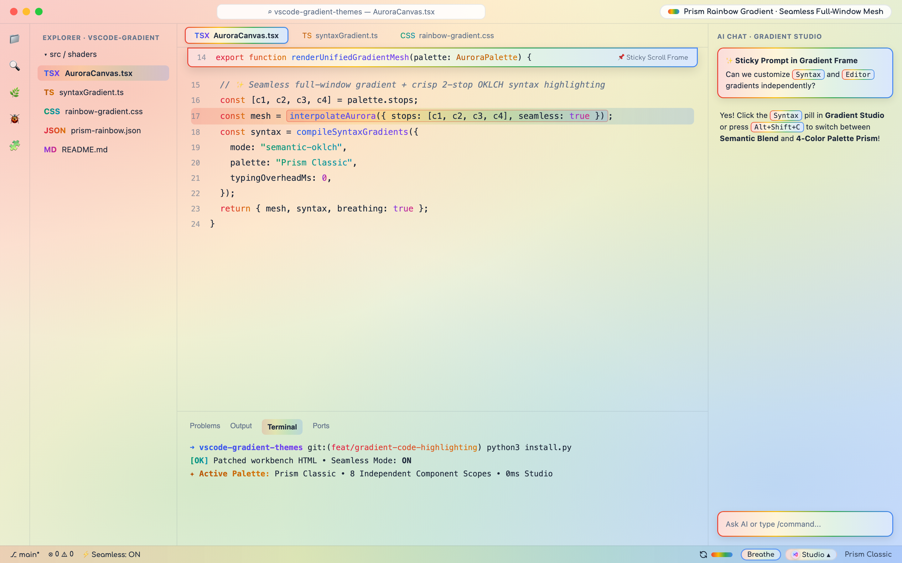
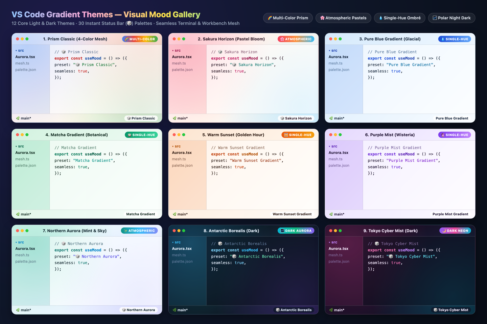
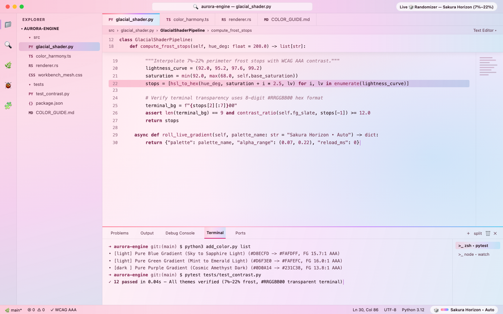
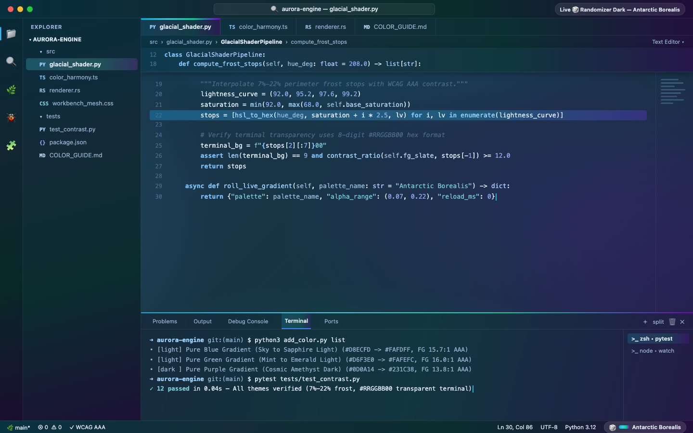
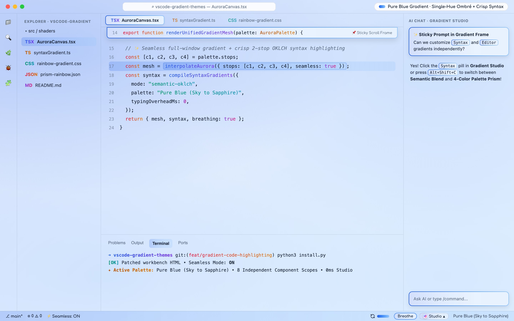

# VS Code Gradient Themes

[](https://marketplace.visualstudio.com/items?itemName=iamqazolp.vscode-gradient-themes)
[](https://marketplace.visualstudio.com/items?itemName=iamqazolp.vscode-gradient-themes)
[](https://github.com/iamqazolp/vscode-gradient-themes)
[](https://github.com/iamqazolp/vscode-gradient-themes/issues)
[](https://github.com/iamqazolp/vscode-gradient-themes/blob/main/LICENSE.txt)

**Full-workbench atmospheric gradient meshes, serene single-hue ombré themes, and a `0ms` Status Bar `🎲` mood roller with 30 curated palettes for VS Code, Cursor, Windsurf, and Antigravity IDE.**





| 🌸 Live `🎲` Randomizer — *Sakura Horizon (Light)* | 🌌 Live `🎲` Randomizer — *Antarctic Borealis (Dark)* |
| :---: | :---: |
|  |  |

---

## ✨ Two Layers that Blend Together

1. **Base Color Theme (`Cmd + K, Cmd + T`)** — Sets your canvas tone (Light or Polar Night Dark) and calm, monochromatic syntax highlighting matched to that color family.
2. **Live `🎲` Gradient Mesh (Status Bar)** — Layers a translucent 4-corner gradient mesh across the Title Bar, Activity Bar, Sidebar, Editor, Terminal, and Status Bar.
   - **Mix & Match:** Pick any Light or Dark base theme in `Cmd + K, Cmd + T`, then click **`🎲`** in the Status Bar to roll 30 curated palettes on top in `0ms` (no reload).
   - **Pure Base Theme Only:** Right-click **`🎲`** (or press `Alt + Shift + 0`) to toggle **`Theme Native` (Overlay Off)** instantly.

---

## 🎨 12 Core Color Themes (`Cmd + K, Cmd + T`)

| Palette Family | ☀️ Light Edition | 🌙 Dark Edition | Visual Vibe |
| :--- | :--- | :--- | :--- |
| **🌈 Prism Rainbow** | `Prism Rainbow Gradient` | `Prism Rainbow Night` | Pastel 4-color prism mesh / Deep aurora night |
| **💧 Pure Blue** | `Pure Blue Gradient` | `Pure Blue Night` | Glacial sapphire sky / Abyssal cobalt |
| **🍵 Matcha** | `Matcha Gradient` | `Matcha Night` | Ceremonial botanical jade / Deep forest emerald |
| **🌅 Warm Sunset** | `Warm Sunset Gradient` | `Warm Sunset Night` | Golden-hour honey amber / Warm twilight ember |
| **🔮 Purple Mist** | `Purple Mist Gradient` | `Purple Mist Night` | Wisteria & lavender mist / Cosmic amethyst |
| **🌸 Pink Blossom** | `Pink Blossom Gradient` | `Pink Blossom Night` | Sakura petal blush / Velvet berry night |



---

## 🎲 30 Live Status Bar Palettes

Click **`🎲`** in the bottom-right Status Bar to roll across **30 curated palettes** (plus procedural harmonic variations):

| 🌈 Multi-Color Prism & Horizon (12) | 🌸 Atmospheric Pastels (10) | 💧 Pure Single-Hue Ombré (8) |
| :--- | :--- | :--- |
| **Prism Classic** *(Blue · Red · Gold · Green)* | **Celestial Peach** *(Apricot · Blush · Ice)* | **Pure Lagoon Cyan** *(Teal → Seafoam)* |
| **Sakura Horizon** *(Rose · Peach · Sky · Mint)* | **Glacier Mint** *(Mint · Aqua · Frost)* | **Pure Apricot Peach** *(Coral → Nectarine)* |
| **Northern Aurora** *(Teal · Mint · Sky · Lavender)* | **Rosewater Champagne** *(Gold · Rose · Sky)* | **Pure Starlight Indigo** *(Indigo → Periwinkle)* |
| **Matcha Hinoki** *(Jade · Bamboo · Amber · Cedar)* | **Starlight Indigo** *(Midnight · Violet · Cyan)* | **Pure Camellia Rose** *(Berry → Flamingo)* |
| **Tokyo Cyber Mist** *(Violet · Magenta · Cyan)* | **Pistachio Cream** *(Pistachio · Vanilla · Coral)* | **Pure Glacier Blue** *(Cobalt → Polar Ice)* |
| **Amalfi Citrus** *(Lemon · Tangerine · Azure)* | **Electric Sunset** *(Crimson · Amber · Purple)* | **Pure Ceremonial Matcha** *(Uji Jade → Mint)* |
| **Golden Hour Dusk** *(Coral · Gold · Rose · Violet)* | **Misty Harbor** *(Sea Mist · Sand · Sage)* | **Pure Sunlit Honey** *(Amber → Champagne)* |
| **Nordic Fjord** *(Glacial Blue · Cyan · Pine)* | **Orchid Breeze** *(Orchid · Lilac · Aqua)* | **Pure Wisteria Violet** *(Amethyst → Lavender)* |
| **Lavender Matcha** *(Wisteria · Rose · Matcha)* | **Desert Mirage** *(Terracotta · Gold · Teal)* | |
| **Opaline Dream** *(Pearl Pink · Baby Blue · Gold)* | **Antarctic Borealis** *(Ice · Emerald · Violet)* | |
| **Kyoto Autumn** *(Maple · Persimmon · Moss)* | | |
| **Bioluminescent Reef** *(Aqua · Neon Cyan · Violet)* | | |

---

## ⚡ Quick Setup & Controls

### Enable Full-Workbench Mesh & `🎲` Randomizer
1. Open the Command Palette (**`Cmd + Shift + P`** / **`Ctrl + Shift + P`**).
2. Run **`Gradient Themes: Enable 4-Color Rainbow Gradient & Live Randomizer`**.
3. Run **`Reload Custom CSS and JS`** → click **Restart** (powered by [`be5invis.vscode-custom-css`](https://marketplace.visualstudio.com/items?itemName=be5invis.vscode-custom-css)).

### Status Bar `🎲` Shortcuts (`0ms`, No Reload)
| Action | Click / Shortcut | What It Does |
| :--- | :--- | :--- |
| **Roll New Mood** | **Left-Click `🎲`** or **`Alt + Shift + G`** | Instantly blends a new 4-color gradient & mesh angle |
| **Reset / Toggle Off** | **Right-Click / `Shift + Click` `🎲`** or **`Alt + Shift + 0`** | Cycles between **Prism Classic** and **Theme Native (Overlay Off)** |
| **Auto-Roll on Startup** | **`Cmd/Ctrl + Click` `🎲`** | Toggles `• Auto` to roll a fresh palette every time VS Code opens |

### Command Palette (`Cmd + Shift + P`)
| Command | ID | Description |
| :--- | :--- | :--- |
| **Gradient Themes: Enable 4-Color Rainbow Gradient & Live Randomizer** | `gradientThemes.enableGradientOverlay` | Injects the 4-color gradient CSS and `🎲` randomizer into `vscode_custom_css.imports` |
| **Gradient Themes: Disable 4-Color Rainbow Gradient Overlay** | `gradientThemes.disableGradientOverlay` | Removes the gradient overlay from `vscode_custom_css.imports` |
| **Gradient Themes: Roll Random Single-Color Glacial Theme** | `gradientThemes.rollRandomTheme` | Switches to a random core theme from the 12-theme suite |
| **Gradient Themes: Open Interactive Theme & Gradient Preview** | `gradientThemes.openPreview` | Opens the interactive webview preview gallery |
| **Gradient Themes: Open GitHub Repository** | `gradientThemes.openGitHub` | Opens `github.com/iamqazolp/vscode-gradient-themes` |
| **Gradient Themes: Report Issue on GitHub (with Diagnostics)** | `gradientThemes.reportIssue` | Opens a pre-filled GitHub issue with IDE, OS, active theme & overlay diagnostics |
| **Gradient Themes: Show Extension Telemetry & Marketplace Stats** | `gradientThemes.showTelemetryStats` | Queries live VS Code Marketplace metrics (`install` vs `downloadCount` vs `updateCount`) and shows author telemetry exclusion status |

---

## 🛠️ Create Your Own Palettes ([`COLOR_GUIDE.md`](https://github.com/iamqazolp/vscode-gradient-themes/blob/main/COLOR_GUIDE.md))

Generate new themes or add custom 4-color presets to the `🎲` randomizer with [`add_color.py`](https://github.com/iamqazolp/vscode-gradient-themes/blob/main/add_color.py):

```bash
# Generate a Light + Dark theme pair from a single hex color
python3 add_color.py theme --name "Pure Cyan" --color "#06B6D4"

# Add a custom 4-stop palette to the Status Bar 🎲 randomizer
python3 add_color.py randomizer --name "Cyber Mint" --stops "#06B6D4,#10B981,#3B82F6,#8B5CF6"

# List all active themes and randomizer presets
python3 add_color.py list
```

---

## License

MIT © [iamqazolp](https://github.com/iamqazolp)
