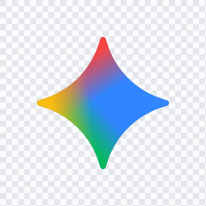
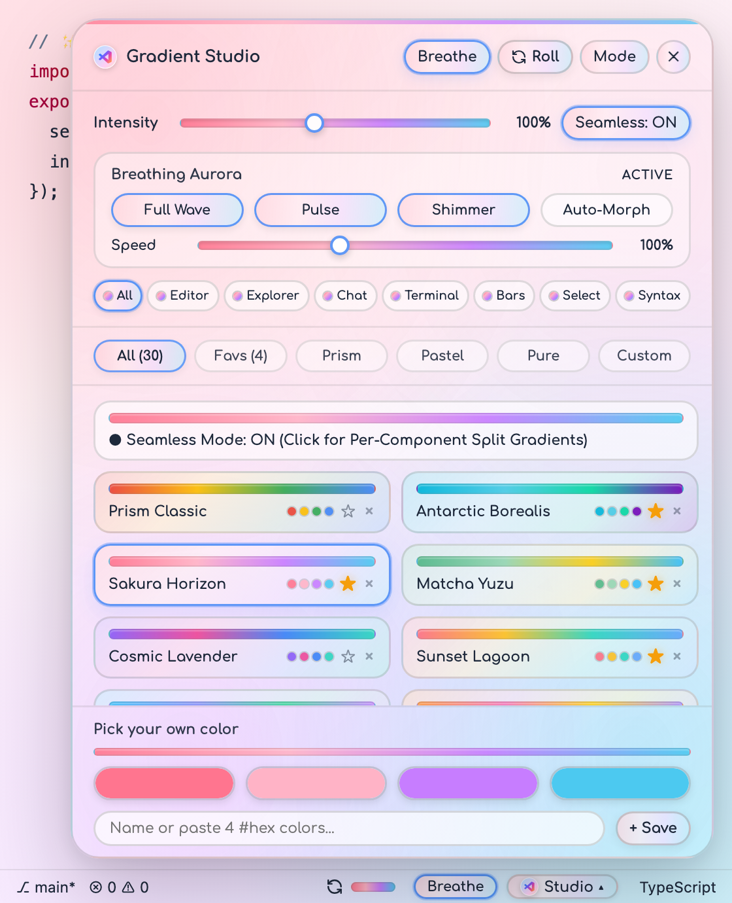
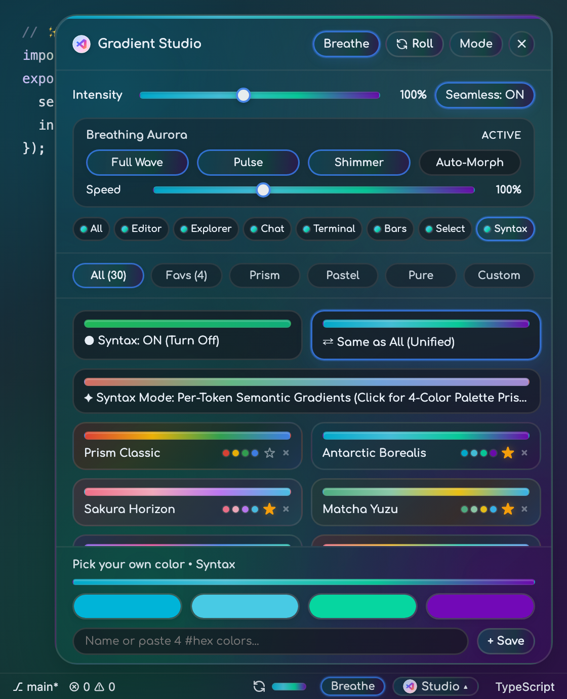
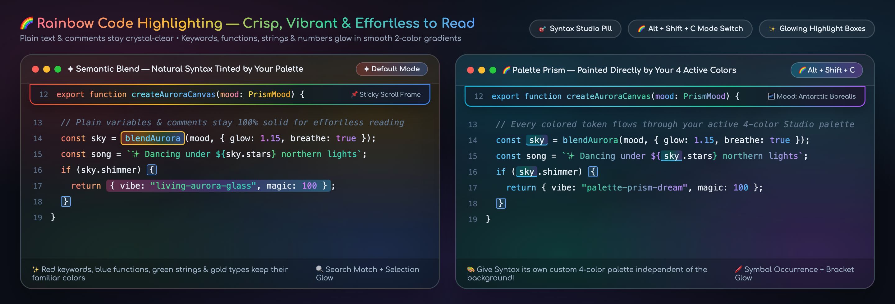

#  VSCode Gradient Themes

> **Turn your code editor into living aurora glass.** Seamless full-window 4-color gradients, rainbow code highlighting, breathing animations, and a live Status Bar **`Gradient Studio`** with **30+ hand-crafted moods** for **VSCode, Cursor, Windsurf, and Antigravity**.

| 🌸 Gradient Studio — *Sakura Horizon (Light)* | 🌌 Gradient Studio — *Antarctic Borealis (Dark)* |
| :---: | :---: |
|  |  |

---

## 🌈 Gradient Code Highlighting (`Alt + Shift + C`)

* **Crisp & Effortless to Read** — Plain variables, punctuation, and comments stay crystal-clear solid text while keywords, functions, strings, and numbers shimmer in smooth 2-color gradients.
* **Two Ways to Glow (`Alt + Shift + C`)** — Keep your theme's natural syntax colors gently tinted by your palette (**Semantic Blend**), or paint your code directly with your active 4-color palette (**Palette Prism**).
* **Glowing Highlights & Sticky Frames** — Text selections, search matches, bracket pairs, and Sticky Scroll headers float inside frosted 4-color gradient frames so scrolling code never bleeds through.

---

## ✨ Sculpt Your Vibe in `0ms` (`Studio ▴` or `Alt + Shift + P`)

* 🪟 **Seamless or Split Panels (`Alt + Shift + S`)** — Let one unbroken gradient flow across your entire window (**`Seamless: ON`**), or give each panel its own directional gradient with a glowing rainbow terminal bar (**`Seamless: OFF`**).
* 🎯 **Color Every Corner Independently** — Pick one palette for **`All`**, or give **`Editor`**, **`Explorer`**, **`Chat`**, **`Terminal`**, **`Bars`**, **`Select`**, and **`Syntax`** their own custom 4-color palettes (or toggle any surface off in 1 click).
* 🫁 **Breathing Aurora (`Alt + Shift + B`)** — Mix **`Full Wave`**, **`Pulse`**, **`Shimmer`**, and **`Auto-Morph`** with a live **`Speed`** slider (`25%–250%`) so your workspace gently breathes while you code.
* 🎨 **30+ Curated Moods & 4-Orb Color Sculptor** — Browse `Prism`, `Pastel`, and `Pure` tabs, star (`★`) your golden favorites, drag the **`Intensity`** slider (`40%–180%`), or pick/paste any 4 `#hex` colors to save your own preset.

---

## 🖼️ Visual Mood Gallery & 12 Core Themes (`Cmd + K, Cmd + T`)

| Family | ☀️ Light Theme | 🌙 Dark Theme | Vibe |
| :--- | :--- | :--- | :--- |
| **🌈 Prism Rainbow** | `Prism Rainbow Gradient (Pastel 4-Color Light)` | `Prism Rainbow Gradient (Aurora 4-Color Dark)` | 4-color pastel prism / Deep aurora night |
| **💧 Pure Blue** | `Pure Blue Gradient (Sky to Sapphire Light)` | `Pure Blue Gradient (Abyssal Cobalt Dark)` | Glacial sapphire sky / Abyssal cobalt |
| **🍵 Pure Green** | `Pure Green Gradient (Mint to Emerald Light)` | `Pure Green Gradient (Forest Emerald Dark)` | Ceremonial botanical jade / Deep forest emerald |
| **🌸 Pure Pink** | `Pure Pink Gradient (Sakura to Rose Light)` | `Pure Pink Gradient (Velvet Berry Dark)` | Sakura petal blush / Velvet berry night |
| **🌅 Pure Yellow** | `Pure Yellow Gradient (Sunlit Honey Light)` | `Pure Yellow Gradient (Golden Amber Dark)` | Golden-hour honey amber / Warm twilight ember |
| **🔮 Pure Purple** | `Pure Purple Gradient (Lavender to Amethyst Light)` | `Pure Purple Gradient (Cosmic Amethyst Dark)` | Wisteria & lavender mist / Cosmic amethyst |

---

## ⌨️ Quick Shortcuts

| Action | Click / Shortcut |
| :--- | :--- |
| **Open Gradient Studio** | Click **`Studio ▴`** in Status Bar or **`Alt + Shift + P`** |
| **Roll Random Mood** | Click **`↻`** in Status Bar or **`Alt + Shift + G`** |
| **Undo / Previous Roll** | **`Alt + Shift + Z`** |
| **Toggle Breathing Aurora** | Click **`Breathe`** or **`Alt + Shift + B`** |
| **Toggle Seamless / Split Panels** | Click **`Seamless: ON`** or **`Alt + Shift + S`** |
| **Switch Code Syntax Mode** | Click Syntax Mode card or **`Alt + Shift + C`** |
| **Rotate 4 Corner Colors** | **`Alt + Shift + R`** |
| **Adjust Gradient Intensity** | Drag **`Intensity`** slider or **`Alt + Shift + Up / Down`** |
| **Toggle Overlay On / Off** | Right-Click **`↻`** or **`Alt + Shift + 0`** |

---

## License

MIT © [iamqazolp](https://github.com/iamqazolp) · CLI theme generator: [`COLOR_GUIDE.md`](https://github.com/iamqazolp/vscode-gradient-themes/blob/main/COLOR_GUIDE.md)
