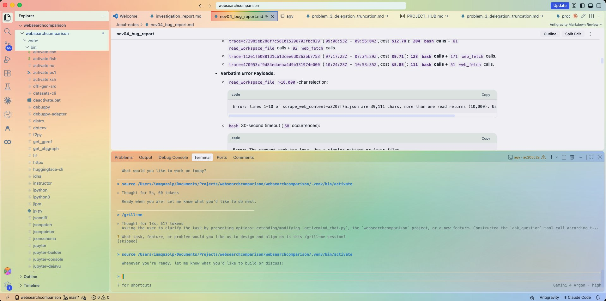
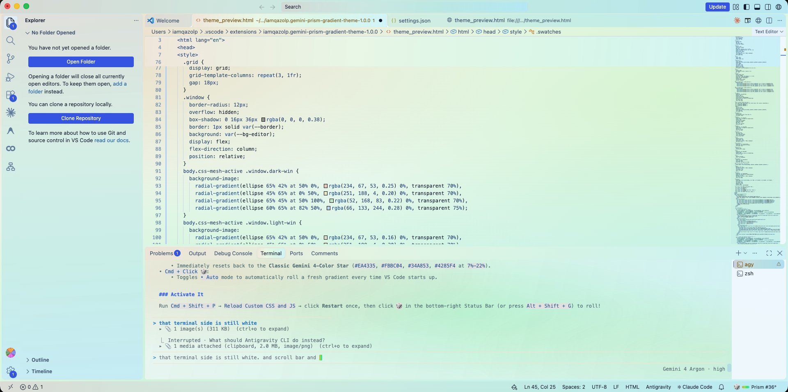
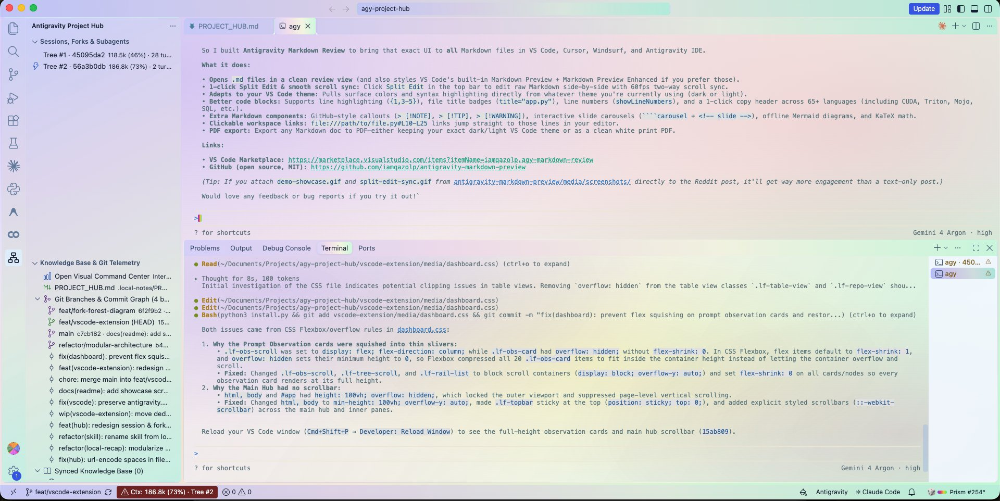
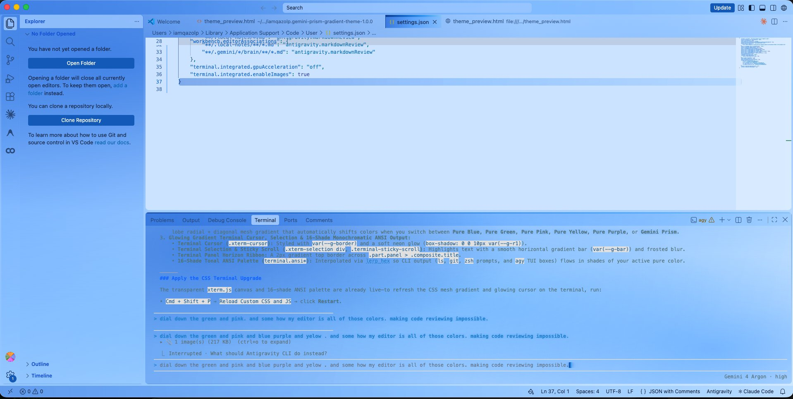

# Gemini Prism & Glacial Gradient Themes

12 `7%–22%` gradient color themes (Light & Dark) + a universal translucent 4-color gradient overlay and live Status Bar randomizer (`🎲`) for VS Code, Cursor, Windsurf, and Antigravity IDE.



| Live `🎲` Randomizer (Editor & Minimap) | Live `🎲` Randomizer (Dashboard & Terminal) | Pure Blue Glacial Theme |
| :---: | :---: | :---: |
|  |  |  |

---

## 1. Color Themes (`Cmd + K, Cmd + T`)

Each single-color theme uses a `7%–22%` perimeter-to-canvas gradient with monochromatic syntax tokens (`13:1–17:1` AAA foreground contrast):

| Family | Light Theme (`vs`) | Dark Theme (`vs-dark`) | Light Stops (`22% → 7%`) | Dark Stops |
| :--- | :--- | :--- | :--- | :--- |
| **Pure Blue** | `Pure Blue Gradient (Sky to Sapphire Light)` | `Pure Blue Gradient (Abyssal Cobalt Dark)` | `#D8ECFD → #FAFDFF` | `#090E16 → #162438` |
| **Pure Green** | `Pure Green Gradient (Mint to Emerald Light)` | `Pure Green Gradient (Forest Emerald Dark)` | `#D6F3E0 → #FAFEFC` | `#08100C → #152A1F` |
| **Pure Pink** | `Pure Pink Gradient (Sakura to Rose Light)` | `Pure Pink Gradient (Velvet Berry Dark)` | `#FADCEB → #FFFBFE` | `#11090E → #2B1925` |
| **Pure Yellow** | `Pure Yellow Gradient (Sunlit Honey Light)` | `Pure Yellow Gradient (Golden Amber Dark)` | `#FBECC0 → #FFFEFA` | `#110E08 → #2A2317` |
| **Pure Purple** | `Pure Purple Gradient (Lavender to Amethyst Light)` | `Pure Purple Gradient (Cosmic Amethyst Dark)` | `#E4D9FC → #FCFBFF` | `#0D0A14 → #231C38` |
| **Gemini Prism** | `Gemini Prism Light (Pastel 4-Color Star)` | `Gemini Prism Dark (4-Color Star)` | `#F9F3DF → #FAF0EE` | `#0E131D → #161116` |

---

## 2. Full-Workbench Rainbow Overlay & `🎲` Randomizer

The CSS overlay blends a `7%–22%` translucent 4-color gradient over your active theme's native `var(--vscode-*-background)` variables—covering the Editor, Sidebar, Sticky Scroll, Scrollbar, and Integrated Terminal (`xterm.js`).

### Enable / Disable
1. Open Command Palette (**`Cmd + Shift + P`** / **`Ctrl + Shift + P`**).
2. Run **`Gemini Prism: Enable 4-Color Rainbow Gradient & Live Randomizer`**.
3. Click **`Reload Custom CSS and JS`** → **Restart** (uses [`be5invis.vscode-custom-css`](https://marketplace.visualstudio.com/items?itemName=be5invis.vscode-custom-css)).

### Status Bar `🎲` Controls (No Reload Needed)
| Action | Shortcut / Click | Effect |
| :--- | :--- | :--- |
| **Roll Gradient** | **Left-Click `🎲`** or **`Alt + Shift + G`** | Rolls a new `7%–22%` 4-color gradient & mesh angle in `0ms` (8 curated palettes + procedural HSL harmonies) |
| **Reset to Classic** | **Right-Click / `Shift + Click` `🎲`** or **`Alt + Shift + 0`** | Resets to the classic Google Gemini 4-Color Star (`#EA4335`, `#FBBC04`, `#34A853`, `#4285F4`) |
| **Auto-Roll on Startup** | **`Cmd/Ctrl + Click` `🎲`** | Toggles `• Auto` mode to roll a fresh gradient whenever VS Code opens |

---

## 3. Adding Custom Colors ([`COLOR_GUIDE.md`](./COLOR_GUIDE.md))

Use [`add_color.py`](./add_color.py) to generate standardized themes or randomizer palettes from a single hex code:

```bash
# 1. Generate a Light + Dark theme pair from one hex color (auto-checks WCAG AAA contrast)
python3 add_color.py theme --name "Pure Cyan" --color "#06B6D4"

# 2. Add a 4-color palette to the Status Bar 🎲 randomizer
python3 add_color.py randomizer --name "Cyber Mint" --stops "#06B6D4,#10B981,#3B82F6,#8B5CF6"

# 3. List all active themes and randomizer palettes
python3 add_color.py list
```

See [**`COLOR_GUIDE.md`**](./COLOR_GUIDE.md) for the exact HSL formulas, WCAG contrast targets, and `xterm.js` `#RRGGBB00` terminal transparency rules.

---

## License

MIT © [iamqazolp](https://github.com/iamqazolp)
